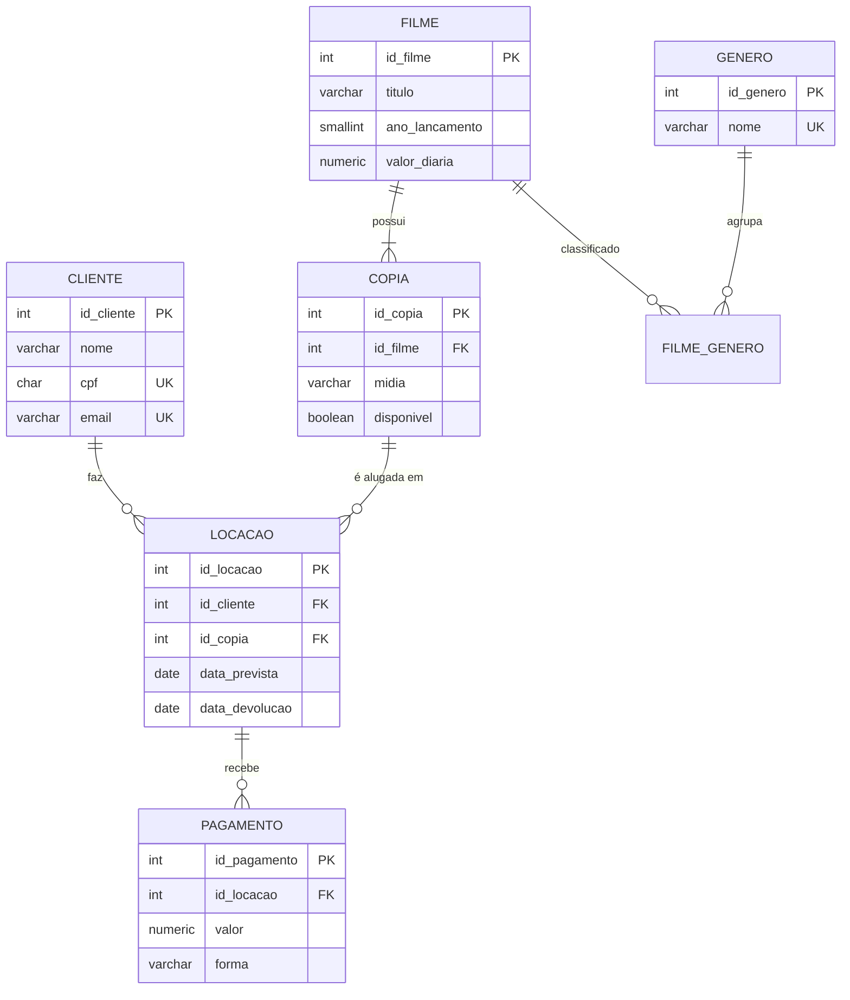

# 🎬 Locadora de Filmes — Banco de Dados

Modelagem e implementação de um banco de dados relacional para uma locadora de filmes, com cadastro de clientes, catálogo, controle de cópias físicas, locações e pagamentos.

Projeto de estudo desenvolvido para praticar **modelagem relacional e SQL** (PostgreSQL).

## 📌 O que o banco resolve

- Saber quais filmes estão disponíveis para locação agora
- Controlar locações em aberto e calcular dias de atraso
- Descobrir os filmes mais alugados
- Ver quanto cada cliente já gastou e quais locações ainda não foram pagas
- Acompanhar o faturamento por forma de pagamento

## 🗂️ Modelo de dados



**Decisões de modelagem**

- **Filme × Cópia:** o filme é o título do catálogo; a cópia é o DVD/Blu-ray físico. Assim uma locadora pode ter várias cópias do mesmo filme.
- **Filme × Gênero (N:N):** um filme pode ter mais de um gênero, por isso a tabela `filme_genero`.
- **Restrições (`CHECK`)** garantem dados válidos: CPF com 11 dígitos, classificação indicativa válida, datas coerentes e valores positivos.
- **Índices** nas colunas mais usadas em buscas e `JOIN`s.

## 🚀 Como executar

Pré-requisito: [PostgreSQL](https://www.postgresql.org/download/) instalado.

```bash
createdb locadora
psql -d locadora -f sql/01_schema.sql
psql -d locadora -f sql/02_dados.sql
psql -d locadora -f sql/03_consultas.sql
psql -d locadora -f sql/04_views.sql
```

Para rodar os testes automatizados (cada teste roda dentro de uma transação e desfaz tudo no final, sem sujar o banco):

```bash
psql -d locadora -v ON_ERROR_STOP=1 -f testes/teste_04_views.sql
# saída esperada: OK: todos os testes das views passaram.
```

## 📁 Estrutura

```
locadora-filmes/
├── README.md
└── sql/
    ├── 01_schema.sql      # tabelas, chaves e restrições
    ├── 02_dados.sql       # dados de exemplo (fictícios)
    ├── 03_consultas.sql   # consultas de negócio
    └── 04_views.sql       # views para relatórios
└── testes/
    └── teste_04_views.sql # testes das views com ASSERT
```

## 📊 Views para relatórios

| View | Para que serve |
|------|----------------|
| `vw_filmes_disponiveis` | Filmes com pelo menos uma cópia livre, com gêneros e quantidade de cópias |
| `vw_locacoes_em_aberto` | Locações ainda não devolvidas, com dias de atraso calculados |
| `vw_locacoes_atrasadas` | Lista de cobrança (com telefone) — view construída sobre a anterior |
| `vw_resumo_clientes` | Total locado, total pago e saldo devedor de cada cliente |

```sql
SELECT cliente, telefone, titulo, dias_atraso
FROM vw_locacoes_atrasadas
ORDER BY dias_atraso DESC;
```

## 🔍 Exemplo de consulta

Locações em aberto com dias de atraso:

```sql
SELECT cl.nome, f.titulo, l.data_prevista,
       GREATEST(CURRENT_DATE - l.data_prevista, 0) AS dias_atraso
FROM locacao l
JOIN cliente cl ON cl.id_cliente = l.id_cliente
JOIN copia c    ON c.id_copia    = l.id_copia
JOIN filme f    ON f.id_filme    = c.id_filme
WHERE l.data_devolucao IS NULL
ORDER BY dias_atraso DESC;
```

## 🛣️ Próximos passos

- [x] Views para relatórios (`vw_filmes_disponiveis`, `vw_locacoes_em_aberto`, `vw_locacoes_atrasadas`, `vw_resumo_clientes`) + testes
- [ ] Função para calcular multa por atraso
- [ ] Trigger que atualiza a disponibilidade da cópia automaticamente
- [ ] Procedure para registrar locação e devolução
- [ ] Rodar os testes SQL automaticamente no GitHub Actions (CI com PostgreSQL)
- [ ] Interface em Python para consultar o banco

## 🛠️ Tecnologias

PostgreSQL · SQL · PL/pgSQL (testes com ASSERT)

---
Feito por **Matheus de Freitas Cunha**
